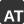

<div align="left">
  
  <br />
  <br />
</div>

[](https://coveralls.io/github/skmtc/skmtc?branch=main)
[](https://opensource.org/licenses/Apache-2.0)
[](https://deno.land/)
[](https://discord.com/invite/Mg88C8Xu5Y)

## Skmtc is an OpenAPI code generation framework for TypeScript

- **Fast** - Github OpenAPI to Zod in 0.51 seconds - 9.5x faster than Orval
- **Composable and modular** - Encapsulate generation logic in modules and reuse
- **Code not config** - Full control over output, variable names and file structure
- **Customisable** - Supports custom edge case handling

## Getting started

### Set up with an agent

Copy this prompt into your coding agent:

```text
Set up Skmtc in this project. Skmtc generates TypeScript code from an OpenAPI document.

1. Install the CLI: curl -fsSL https://skmtc.dev/install | sh
   On Windows, in PowerShell: irm https://skmtc.dev/install.ps1 | iex
   Then run skmtc --version. It must print a version.
2. If you support skills, run: npx skills add skmtc/skmtc --skill skmtc-cli skmtc-generator --yes
3. Find the OpenAPI document of this project. If you cannot find one, ask me for its path or URL. Ask me which generators I want. https://jsr.io/@skmtc lists them.
4. From the project root, run:
   skmtc init <project> <basePath>
   skmtc install <generators> <project>
   skmtc generate <project> <schema> --save
   <project> is a short name in kebab case. <basePath> is the folder that the "@/" import alias of this project points to, such as src. Generated files import each other through that alias. You can leave <basePath> out when a tsconfig or deno.json states the alias: init then uses its folder. If init or skmtc doctor warns that basePath and the alias differ, or the project has no such alias, ask me before you change either. --save stores the schema in the project config, so later runs are skmtc generate <project>.
5. Add a note to AGENTS.md, and create the file if needed: before Skmtc work, run skmtc agent-context --json, then read the guide topic for the job with skmtc guide <topic>. To write or change a generator, follow the skmtc-generator skill. Do not edit a generated file. Change the settings or the generator, then run skmtc generate again.

If a command fails, run skmtc doctor and show me its report. Do not edit .skmtc/<project>/deno.json, delete a lockfile or change Deno's minimum dependency age to get past an error.
```

The prompt installs the CLI and the skills, generates code from your OpenAPI
document, and adds a note to `AGENTS.md` that sends each later session to
`skmtc agent-context` and to the guide that the CLI carries (`skmtc guide`).

### Set up yourself

The same path by hand: install the CLI, then run three commands.

#### 1. Install Skmtc

macOS and Linux:

```bash
curl -fsSL https://skmtc.dev/install | sh
```

Windows (PowerShell):

```powershell
irm https://skmtc.dev/install.ps1 | iex
```

This installs the latest `skmtc` CLI, bootstrapping [Deno](https://deno.com)
(its runtime) automatically if it isn't already installed. To pin a specific
version on macOS and Linux, set `SKMTC_VERSION` for `sh`:

```bash
curl -fsSL https://skmtc.dev/install | SKMTC_VERSION=0.9.26 sh
```

On Windows, set it in PowerShell:

```powershell
$env:SKMTC_VERSION = '0.9.26'; irm https://skmtc.dev/install.ps1 | iex
Remove-Item Env:SKMTC_VERSION   # otherwise the pin stays set in this window
```

On Windows, a project formatter and linked-repository detection still run
through `sh`, which [Git for Windows](https://git-scm.com/download/win)
provides. Run `skmtc` from Git Bash, or add Git's `usr\bin` folder to `PATH`.
`--typecheck` does not work on Windows yet, and can report a pass without
checking anything ([#353](https://github.com/skmtc/skmtc/issues/353)). Run `tsc`
yourself instead.

#### 2. Create a project and generate

```bash
# Create a project: its name, and the folder for generated code
skmtc init petstore src/generated

# Add a generator from JSR
skmtc install @skmtc/gen-zod petstore

# Generate from an OpenAPI document: a URL or a local path.
# --save stores it, so the next run is `skmtc generate petstore`.
skmtc generate petstore https://petstore3.swagger.io/api/v3/openapi.json --save
```

The generated files are in `src/generated/`. They import each other through
the `@/` alias, so in an app the folder you give to `init` is the one that
alias points to. When a tsconfig or a `deno.json` states the alias, `init`
reads it: leave the folder out and it uses the right one, and
`skmtc doctor` reports a mismatch.
[Your first generation](deno/docs/using/tutorials/01-your-first-generation.md)
explains each step.

`skmtc` with no arguments opens a terminal UI that does the same steps:


### Install the agent skills

Two skills teach a coding agent to work with Skmtc, and ship from the same
commit as the code they describe. `skmtc-generator` is for writing and editing
generators: one entry that routes to references for model generators,
operation generators, the engine and the TypeScript layer, with a skeleton to
copy. `skmtc-cli` says when to use the CLI and sends the agent to the guide
that the CLI carries (`skmtc guide`). In Claude Code, `skmtc-cli` is a plugin
of its own, and installing `skmtc` installs it too.

```bash
# Claude Code
/plugin marketplace add skmtc/skmtc
/plugin install skmtc@skmtc

# any skills-capable agent
npx skills add skmtc/skmtc --skill skmtc-cli skmtc-generator
```

The setup prompt above runs the second form. The sources live in
[`deno/docs/skills/`](deno/docs/skills/) and read fine on their own; each is
also rendered at [skmtc.dev/skills](https://skmtc.dev/skills).

This README is the one place the setup prompt and the install lines are
written down — everything else points here, and `verify-docs` fails on a copy
of the install lines in another file. Instructions that exist twice drift, and
the reader who finds the stale one has no way to tell.

## Available generators

|                | Libraries          | Generator repo        | Status |
| -------------- | ------------------ | --------------------- | ------ |
|  | Arktype | [@skmtc/gen-arktype](https://github.com/skmtc/skmtc-generators/tree/main/gen-arktype) | 🚀 Now |
|  | TypeScript | [@skmtc/gen-typescript](https://github.com/skmtc/skmtc-generators/tree/main/gen-typescript) | 🚀 Now |
|  | Valibot | [@skmtc/gen-valibot](https://github.com/skmtc/skmtc-generators/tree/main/gen-valibot) | 🚀 Now |
|  | Zod | [@skmtc/gen-zod](https://github.com/skmtc/skmtc-generators/tree/main/gen-zod) | 🚀 Now |
|  | MSW | [@skmtc/gen-msw](https://github.com/skmtc/skmtc-generators/tree/main/gen-msw) | 🚀 Now |
|   | Supabase + Hono | [@skmtc/gen-supabase-hono](https://github.com/skmtc/skmtc-generators/tree/main/gen-supabase-hono) | 🚀 Now |
| | Express | [@skmtc/gen-express](https://github.com/skmtc/skmtc-generators/tree/main/gen-express) | 🚀 Now |
|   | React Query (Fetch + Zod) | [@skmtc/gen-tanstack-query-fetch-zod](https://github.com/skmtc/skmtc-generators/tree/main/gen-tanstack-query-fetch-zod) | 🚀 Now |
|    | React Query (Supabase + Zod) | [@skmtc/gen-tanstack-query-supabase-zod](https://github.com/skmtc/skmtc-generators/tree/main/gen-tanstack-query-supabase-zod) | 🚀 Now |
|  | Shadcn Form | [@skmtc/gen-shadcn-form](https://github.com/skmtc/skmtc-generators/tree/main/gen-shadcn-form) | 🚀 Now |
|  | Shadcn Select | [@skmtc/gen-shadcn-select](https://github.com/skmtc/skmtc-generators/tree/main/gen-shadcn-select) | 🚀 Now |
|  | Shadcn Table | [@skmtc/gen-shadcn-table](https://github.com/skmtc/skmtc-generators/tree/main/gen-shadcn-table) | 🚀 Now |
| | DaisyUI Form | [@skmtc/gen-daisyui-form](https://github.com/skmtc/skmtc-generators/tree/main/gen-daisyui-form) | 🚀 Now |
| | GraphQL Operation | [@skmtc/gen-graphql-operation](https://github.com/skmtc/skmtc-generators/tree/main/gen-graphql-operation) | 🚀 Now |
| | GraphQL Typed Document Node | [@skmtc/gen-graphql-typed-document-node](https://github.com/skmtc/skmtc-generators/tree/main/gen-graphql-typed-document-node) | 🚀 Now |

## Performance vs other code generators

```
🚀 Time to convert Github OpenAPI to Zod schemas (lower is better)

skmtc-zod       0.51s   ██▎ 1.0x
orval-zod       4.85s   ████████████████████▎ 9.5x
kubb-zod        7.63s   ███████████████████████████████▉ 14.9x
openapi-ts-zod  11.95s  █████████████████████████████████████████████████▉ 23.3x
                        ◺ 0.00                                     12.00 ◿
```
See [openapi-codegen-benchmarks](https://github.com/skmtc/openapi-codegen-benchmarks) for full details

<!-- ## 
## How does it work?

Skmtc handles all OpenAPI parsing and output rendering, which means each generator only needs to specify how to represent its API schema input as a code string.

The process runs in 3 phases

1. **Parse** - Converts input OpenAPI schema into an **OasDocument** object
2. **Generate** - Creates **Projection** objects from operations and models in OasDocument and writes them to respective **File** objects
3. **Render** - Outputs generated **File** objects as code files

Let's take a look at an example, where we create a `fetch` based API client with Zod type checking

```typescript
import { ZodInsertable } from '@skmtc/gen-zod'

class ZodFetch extends BaseProjection {
  zodName: string;

  constructor({context, operation, settings}){
    super({context, operation, settings})

    // To add Zod type checks, we look up the response schema for each operation,
    const response = operation.toSuccessResponse()?.resolve().toSchema()

    // generate a Zod schema from it and insert it into current file
    const zodResponse = this.insert(ZodInsertable, response)

    // Assign schema name to object so it can be accessed from `toString()` below
    this.zodName = zodResponse.identifier.name
  }

  // Map object properties to output code
  toString(){
    return `() => {
      const res = await fetch('${this.operation.path}')
      const data = await res.json()

      return ${zodName}.parse(data)
    }`
  }
}
```
-->

## Contributing

We welcome contributions! Check out our [Contributing Guide](CONTRIBUTING.md) to get started.

<!-- ## 📚 Documentation

- [Full Documentation](https://docs.skmtc.dev)
- [API Reference](https://docs.skmtc.dev/api)
- [Custom Generators Guide](https://docs.skmtc.dev/generators)
- [Examples](https://github.com/skmtc/skmtc/tree/main/examples) -->

## Support

- [GitHub Issues](https://github.com/skmtc/skmtc/issues) - Bug reports and feature requests
- [Discord Community](https://discord.com/invite/Mg88C8Xu5Y) - Get help and share your experience

## License

Apache 2.0 © [Skmtc Contributors](LICENSE.md)
